# 📚 Dokumentasi Lengkap — Wedding Invitation Management System

Selamat datang di pusat dokumentasi **Wedding Invitation Management System (WIMS)**. Folder `word/` ini berisi panduan lengkap langkah demi langkah untuk **memasang aplikasi di akun Google Apps Script siapa saja** serta **panduan cara penggunaan seluruh fitur** dari awal hingga hari pelaksanaan acara pernikahan.

---

## 🗂️ Daftar Dokumen di Folder Ini

1. **[01-PANDUAN-INSTALASI-APPSCRIPT.md](./01-PANDUAN-INSTALASI-APPSCRIPT.md)**
   Panduan dari nol untuk mengonfigurasi aplikasi ini di akun Google (Gmail) milikmu sendiri atau milik klien/orang lain:
   - Cara menyiapkan Google Spreadsheet sebagai database.
   - Cara memasukkan kode ke Google Apps Script (bisa **Copy-Paste Manual lewat Browser** atau **Otomatis lewat Terminal `clasp`**).
   - Cara menghubungkan `SPREADSHEET_ID` dan menginisialisasi 8 Sheet database otomatis.
   - Cara men-deploy menjadi **Web App** dan mengatur izin akses (*Execute as: Me*, *Who has access: Anyone*).
   - Cara mengatasi masalah umum (*Troubleshooting*).

2. **[02-PANDUAN-PENGGUNAAN-ADMIN-DAN-TAMU.md](./02-PANDUAN-PENGGUNAAN-ADMIN-DAN-TAMU.md)**
   Panduan operasional lengkap untuk pemilik acara (Admin) dan petugas lapangan:
   - Cara login awal & mengganti password Admin demi keamanan.
   - Cara memilih **5 Desain Template Undangan** dan mengedit isi acara, foto pasangan, galeri Google Drive, serta musik latar.
   - Cara menambah tamu satu per satu atau **Import Massal dari CSV / Excel**.
   - Cara mengirim undangan WhatsApp menggunakan **Mode 1-Klik Gratis (`wa.me`)** maupun **Mode Antrean Otomatis WhatsApp Cloud API Resmi**.
   - Cara memantau konfirmasi kehadiran (RSVP) dan moderasi buku ucapan.
   - Cara menggunakan kamera HP untuk **Scan QR Code Check-in** tamu di meja penerima tamu gedung.
   - Cara mengunduh laporan CSV dan mencetak laporan PDF.

---

## ⚡ Ringkasan Alur Kerja Sistem

```mermaid
flowchart LR
    A["Admin Login ke Dashboard"] --> B["Pilih 1 dari 5 Desain Template & Edit Acara"]
    B --> C["Tambah / Import Daftar Tamu (CSV / Excel)"]
    C --> D["Sistem Buat Token & Link Unik per Tamu"]
    D --> E["Kirim Undangan via 1-Klik WA Gratis / Cloud API"]
    E --> F["Tamu Buka Link Mobile (?token=...)"]
    F --> G["Tamu Isi Form RSVP & Doa Ucapan"]
    G --> H["Tamu Tunjukkan QR Code di Gedung Acara"]
    H --> I["Petugas Scan QR Check-in & Cetak Laporan"]
```

---

## 🔐 Ringkasan Kredensial Awal (Instalasi Baru)

Saat pertama kali database diinisialisasi pada akun Google baru, sistem membuat akun Admin bawaan berikut:
- **Username**: `admin`
- **Password**: `Admin123!`

> **⚠️ Penting**: Segera ubah password bawaan tersebut setelah berhasil login pertama kali melalui menu **Pengaturan Sistem $\rightarrow$ Keamanan & Kredensial Akun Admin**.
